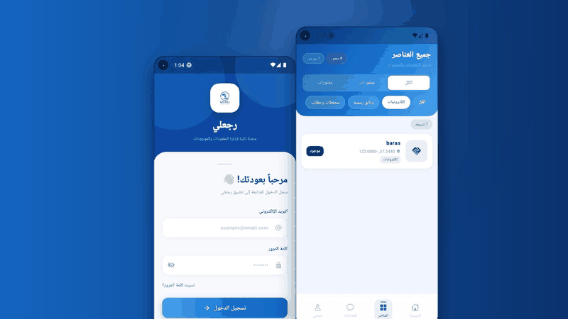
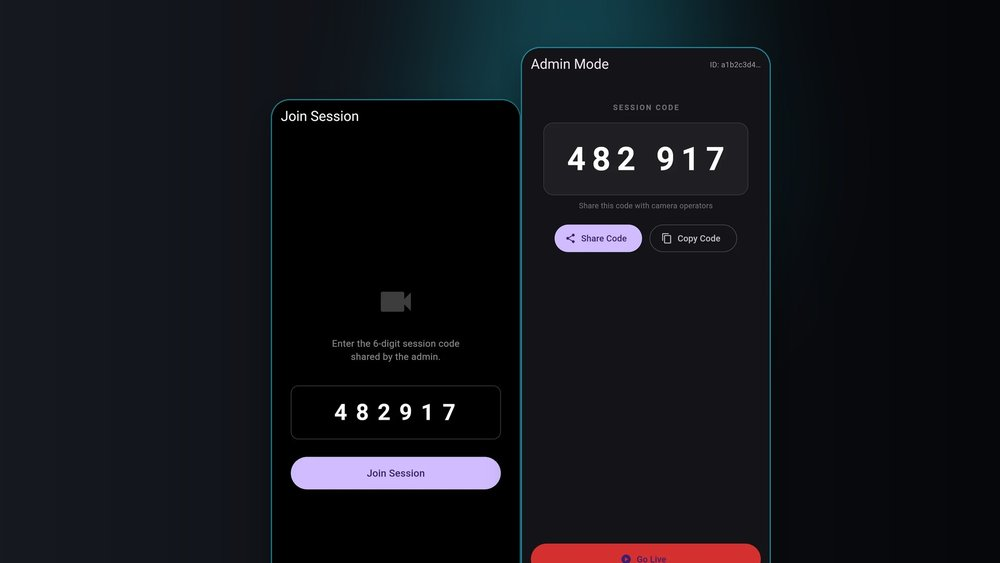
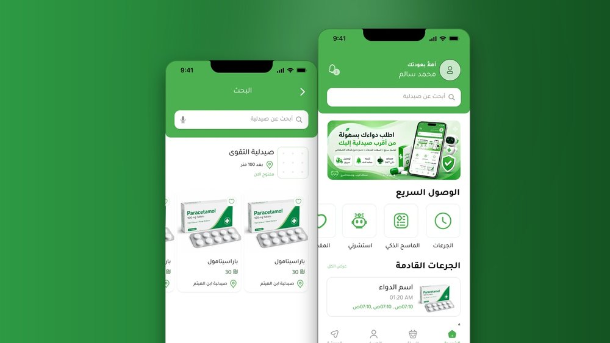
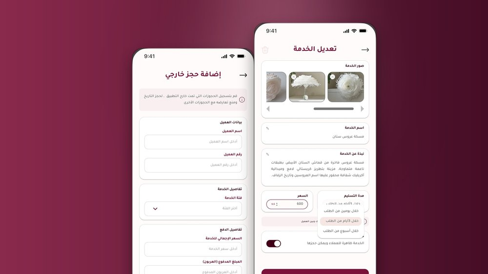

 

---

## 🚀 About Me

Computer Science graduate (Al-Aqsa University) with **4 years** of experience in mobile development. I build **Flutter** apps with clean, responsive UI, and I work as both **developer and system analyst** on my projects, from the idea and the screens to the working app.

- 📱 **Mobile:** cross-platform apps with Flutter
- 💻 **Web:** front-end development (HTML, CSS, JS)
- 🎨 **Design:** UI/UX in Figma, wireframes and prototypes
- 📍 Based in Gaza, available for freelance work

---

## 📱 My Apps

  

 

<table>
<tr>
<td width="50%" valign="top">

### 🔎 Rajeali (رجعلي)

Smart platform for managing lost and found items: login, item lists with filters, and map location.
`Flutter` `Dart`

[📖 Case study](https://baraaelh.github.io/my-portfolio/work/rajeali.html) · [⬇️ Download APK](https://github.com/Baraaelh/Baraaelh/releases)

</td>
<td width="50%" valign="top">

### 🎬 Multicam Studio

Multi-camera studio app built with Flutter.
`Flutter` `Dart`

[📖 Case study](https://baraaelh.github.io/my-portfolio/work/multicam.html) ·    [⬇️ Download APK](https://github.com/Baraaelh/Baraaelh/releases/download/Multicam/app-release.apk)

</td>
</tr>
<tr>
<td width="50%" valign="top">

### 💊 PharmacyLink

Online pharmacy app with an AI assistant for medical consultations, local storage with SQLite, and a full Figma design system.
`Flutter` `GetX` `Dio` `Figma`

[📖 Case study](https://baraaelh.github.io/my-portfolio/work/pharmacylink.html) · [🎨 Figma design](https://www.figma.com/design/Ghv1qFhOrtJzOPbva77xev/pharmacyApp?node-id=0-1&p=f&t=GUHPGgY7esij9S16-0)

</td>
<td width="50%" valign="top">

### 💍 Farah (فرح)

Wedding-services marketplace for Gaza: UI/UX design and system analysis.
`Figma` `UI/UX` `SRS`

[📖 Case study](https://baraaelh.github.io/my-portfolio/work/farah.html)

</td>
</tr>
</table>

### 🎨 More UI designs

| Project | Description | Design |
|---|---|---|
| 👟 Shoe Store App | Modern footwear e-commerce app with a clean UI | [Figma](https://www.figma.com/design/itS2fgm9Yn9O1lJNqlHN9m/shoe-store?node-id=0-1&p=f&t=X8tBhhOBbsgoROYU-0) |
| 🤝 Charity & Donation App | Platform for donations and charitable projects | [Figma](https://www.figma.com/design/MuRl8RRuoNpGDKdc3X0b07/Untitled?node-id=0-1&p=f&t=oGIUHgULFYJbovpC-0) |
| 🍔 Food Portfolio | Restaurant app with a "Food Portfolio" concept | [Figma](https://www.figma.com/design/0h1o7qTtrcSh8TkppNFAUt/Untitled?node-id=0-1&p=f&t=OCFN8xHELIqiY5n1-0) |

---

## 🛠 Skills & Tools

---

## 📊 GitHub Stats

  
  

---

### 💬 Have an app idea? Let's build it.

